# CloudInn — Arquitetura de Sistema (arc42)

**Versão da Arquitetura:** 3.0.0-PROPOSTA
**Data:** Outubro de 2026
**Template:** arc42 (Versão 8.2-PT)
**Grupo Acadêmico:** 10
**Status do Documento:** Revisão Arquitetural Proposta (Preparação para Implementação)
**Documento Complementar:** [Software Architecture Canvas](software-architecture-canvas-cloudinn.md)

---

## Equipe de Engenharia e Arquitetura

| Integrante                   | Papel na Arquitetura e Engenharia                        |
| :--------------------------- | :------------------------------------------------------- |
| **Alyson Ferreira de Souza** | Integrações Serverless, Pipeline de Dados e Persistência |
| **Flavia Cristina Fagundes** | Requisitos, Modelagem de Domínio e Contratos OpenAPI     |
| **Lucas Aioria Serpa**       | Microfrontend React, Motion Design e UX Operacional      |
| **Matheus Pereira Siqueira** | Infraestrutura em Nuvem, Resiliência e Segurança         |

---

## Quadro de Transição e Migração Arquitetural

A presente documentação substitui formalmente a arquitetura legada (versão 2.0.0, em que Azure Functions realizavam diretamente o CRUD e acessavam uma única base MongoDB compartilhada). O quadro a seguir explicita o que **permanece**, o que **muda** e o que é **descontinuado**:

| Dimensão                      | Arquitetura Anterior (v2.0 - Legada)                         | Arquitetura-Alvo (v3.0 - Projetada)                                  | Classificação             |
| :---------------------------- | :----------------------------------------------------------- | :------------------------------------------------------------------- | :------------------------ |
| **Interface do Usuário**      | React SPA com Vite, Tailwind CSS e Motion                    | Mesma aplicação React SPA preservada integralmente                   | **PERMANECE**             |
| **Regras Hoteleiras**         | RF01 a RF11 (Reservas, Check-in, Check-out, Limpeza)         | Mesmos fluxos de negócio, agora remapeados por domínio               | **PERMANECE (Remapeado)** |
| **Topologia de Backend**      | Azure Functions acessando banco diretamente                  | Microfrontend -> BFF -> API Gateway -> Microsserviços                | **NOVO / MUDA**           |
| **Camada de Orquestração**    | Inexistente (chamadas dispersas pelo frontend)               | BFF Node.js (NestJS) com endpoint `GET /aggregated-data`             | **NOVO / MUDA**           |
| **Roteamento & Borda**        | Inexistente (endpoints públicos individuais de Functions)    | API Gateway (Azure API Management) como intermediário central        | **NOVO / MUDA**           |
| **Persistência de Dados**     | MongoDB compartilhado entre todas as entidades               | _Database per Service_: MongoDB Atlas (Hotel) + Azure SQL (Reservas) | **NOVO / MUDA**           |
| **Comunicação Interserviços** | Acoplamento direto por persistência compartilhada            | Event-Driven Architecture (EDA) via Azure Service Bus Topics         | **NOVO / MUDA**           |
| **Papel do Serverless**       | CRUD autoritativo de entidades de negócio                    | Funções dedicadas exclusivamente a cálculos analíticos pesados       | **NOVO / MUDA**           |
| **Padrão de Código**          | Handlers de Functions orientados a script procedural         | Clean Architecture, SOLID e Vertical Slice Architecture (NestJS)     | **NOVO / MUDA**           |
| **CRUD em Functions**         | `fc_gp_cloudInn_insert`, `update`, `delete`, `select`        | Descontinuados como arquitetura vigente; movidos para microsserviços | **DESCONTINUADO**         |
| **Banco Único Compartilhado** | MongoDB único com coleções `reservations`, `rooms`, `guests` | Descontinuado; proibido acesso cruzado ou FKs físicas interbancos    | **DESCONTINUADO**         |

---

## Sumário Executivo

- [1. Introdução e Objetivos](#1-introdução-e-objetivos)
  - [1.1 Visão Geral do Sistema](#11-visão-geral-do-sistema)
  - [1.2 Requisitos Funcionais Remapeados (RF01–RF11 e Novos)](#12-requisitos-funcionais-remapeados-rf01rf11-e-novos)
  - [1.3 Ciclo de Estados de Reservas e Quartos](#13-ciclo-de-estados-de-reservas-e-quartos)
  - [1.4 Objetivos de Qualidade (ISO/IEC 25010)](#14-objetivos-de-qualidade-isoiec-25010)
  - [1.5 Partes Interessadas (Stakeholders)](#15-partes-interessadas-stakeholders)
  - [1.6 Matriz de Rastreabilidade Funcional](#16-matriz-de-rastreabilidade-funcional)
- [2. Restrições Arquiteturais](#2-restrições-arquiteturais)
  - [2.1 Restrições Tecnológicas e de Software](#21-restrições-tecnológicas-e-de-software)
  - [2.2 Restrições Organizacionais, Nuvem e Custos](#22-restrições-organizacionais-nuvem-e-custos)
- [3. Contexto e Escopo](#3-contexto-e-escopo)
  - [3.1 Contexto de Negócio](#31-contexto-de-negócio)
  - [3.2 Diagrama C4 Nível 1 — Contexto do Sistema](#32-diagrama-c4-nível-1--contexto-do-sistema)
  - [3.3 Contexto Técnico e Interfaces Externas](#33-contexto-técnico-e-interfaces-externas)
- [4. Estratégia de Solução](#4-estratégia-de-solução)
  - [4.1 Princípios Norteadores e Trade-Offs](#41-princípios-norteadores-e-trade-offs)
  - [4.2 Software Architecture Canvas Integrado](#42-software-architecture-canvas-integrado)
- [5. Visão de Blocos de Construção](#5-visão-de-blocos-de-construção)
  - [5.1 Diagrama C4 Nível 2 — Containers](#51-diagrama-c4-nível-2--containers)
  - [5.2 Diagramas C4 Nível 3 — Componentes por Container](#52-diagramas-c4-nível-3--componentes-por-container)
  - [5.3 Diagramas C4 Nível 4 — Código por Vertical Slice](#53-diagramas-c4-nível-4--código-por-vertical-slice)
  - [5.4 Diagrama UML de Componentes Distribuídos](#54-diagrama-uml-de-componentes-distribuídos)
  - [5.5 Diagrama UML de Classes de Domínio](#55-diagrama-uml-de-classes-de-domínio)
  - [5.6 Modelagem de Dados e Persistência Segregada](#56-modelagem-de-dados-e-persistência-segregada)
- [6. Visão de Tempo de Execução](#6-visão-de-tempo-de-execução)
  - [6.1 Cenário 1: Carregamento do Painel Agregado](#61-cenário-1-carregamento-do-painel-agregado)
  - [6.2 Cenário 2: Ingestão de Reserva via OTA e Anti-Overbooking](#62-cenário-2-ingestão-de-reserva-via-ota-e-anti-overbooking)
  - [6.3 Cenário 3: Fluxo de Check-in e Sincronização](#63-cenário-3-fluxo-de-check-in-e-sincronização)
  - [6.4 Cenário 4: Check-out e Ciclo de Governança](#64-cenário-4-check-out-e-ciclo-de-governança)
  - [6.5 Cenário 5: Cálculos Analíticos sob Demanda via Azure Function](#65-cenário-5-cálculos-analíticos-sob-demanda-via-azure-function)
  - [6.6 Cenário 6: Resiliência, Retries, Compensação e DLQ](#66-cenário-6-resiliência-retries-compensação-e-dlq)
- [7. Visão de Implantação](#7-visão-de-implantação)
  - [7.1 Topologia em Nuvem (Microsoft Azure &amp; MongoDB Atlas)](#71-topologia-em-nuvem-microsoft-azure--mongodb-atlas)
  - [7.2 Estratégia de Conteinerização e Docker Hub](#72-estratégia-de-conteinerização-e-docker-hub)
  - [7.3 Gestão de Ambientes e Segredos](#73-gestão-de-ambientes-e-segredos)
- [8. Conceitos Transversais](#8-conceitos-transversais)
  - [8.1 Clean Architecture, SOLID e Vertical Slice Architecture](#81-clean-architecture-solid-e-vertical-slice-architecture)
  - [8.2 Contrato JSON Agregado do BFF (`GET /aggregated-data`)](#82-contrato-json-agregado-do-bff-get-aggregated-data)
  - [8.3 Comunicação Orientada a Eventos (EDA)](#83-comunicação-orientada-a-eventos-eda)
  - [8.4 Segurança, RBAC e Conformidade com LGPD](#84-segurança-rbac-e-conformidade-com-lgpd)
  - [8.5 Observabilidade, Rastreamento Distribuído e Telemetria](#85-observabilidade-rastreamento-distribuído-e-telemetria)
- [9. Decisões Arquiteturais (ADRs)](#9-decisões-arquiteturais-adrs)
- [10. Requisitos de Qualidade](#10-requisitos-de-qualidade)
- [11. Riscos e Dívidas Técnicas](#11-riscos-e-dívidas-técnicas)
- [12. Glossário](#12-glossário)
- [Anexo: Matriz de Evidências Futuras de Entrega](#anexo-matriz-de-evidências-futuras-de-entrega)

---

## 1. Introdução e Objetivos

### 1.1 Visão Geral do Sistema

O **CloudInn** é um sistema corporativo de gestão hoteleira (_Property Management System_ — PMS) projetado para automatizar integralmente o ciclo de hospedagem de estabelecimentos independentes e redes hoteleiras. A plataforma gerencia desde a recepção de hóspedes, atribuição e precificação de aposentos, rotinas de governança e higienização, até a ingestão autenticada e idempotente de reservas originadas por canais parceiros e agências de viagens online (OTAs — _Online Travel Agencies_, tais como Booking.com, Airbnb e Expedia).

Nesta revisão arquitetural (versão 3.0.0), o CloudInn evolui de um protótipo com persistência acoplada para uma **arquitetura de microsserviços distribuída orientada a eventos**, mantendo intacta a experiência do usuário do microfrontend React e estabelecendo padrões de isolamento de dados (_Database per Service_), orquestração de entrada com BFF e API Gateway, e processamento serverless para rotinas analíticas intensivas.

### 1.2 Requisitos Funcionais Remapeados (RF01–RF11 e Novos)

Os requisitos funcionais originais do CloudInn foram preservados em sua intenção de negócio e remapeados para seus domínios legítimos, acrescidos das novas capacidades mandatórias:

|    ID    | Requisito Funcional                           | Descrição Detalhada                                                                                                                                 | Bounded Context / Serviço Proprietário  | Mecanismo de Persistência                                |
| :------: | :-------------------------------------------- | :-------------------------------------------------------------------------------------------------------------------------------------------------- | :-------------------------------------- | :------------------------------------------------------- |
| **RF01** | **Ingestão de Notificações de Reservas**      | Receber, autenticar e processar notificações de reservas de canais parceiros/OTAs em formato JSON com controle estrito de idempotência.             | Reservas/Guests Service                 | Azure SQL Database (Tabela `IdempotencyKeys`)            |
| **RF02** | **Cadastro e Gestão de Hóspedes**             | Criar, consultar e atualizar dados cadastrais de hóspedes (nome, documento/CPF, e-mail, telefone, status VIP) com prevenção de duplicidades.        | Reservas/Guests Service                 | Azure SQL Database (Tabela `Guests`)                     |
| **RF03** | **Ciclo de Vida de Reservas**                 | Registrar e controlar os estados formais de reservas (`pending`, `confirmed`, `active`, `completed`, `cancelled`), mantendo histórico de auditoria. | Reservas/Guests Service                 | Azure SQL Database (Tabela `Reservations`)               |
| **RF04** | **Validação Temporal de Estadias**            | Validar regras de negócio sobre datas de check-in e check-out, impedindo estadias com datas retroativas ou check-out anterior/igual ao check-in.    | Reservas/Guests Service                 | Azure SQL Database (Value Object `DateRange`)            |
| **RF05** | **Alocação e Prevenção de Conflitos**         | Associar reserva a quarto/tipologia e validar disponibilidade por intervalo de datas, prevenindo _overbooking_ sob concorrência simultânea.         | Reservas/Guests Service                 | Azure SQL Database (Query transacional com lock)         |
| **RF06** | **Status Operacional dos Quartos**            | Consultar e alterar os estados físicos dos quartos (`available`, `reserved`, `occupied`, `dirty`, `cleaning`), refletindo no painel da recepção.    | Hotel Service                           | MongoDB Atlas (Coleção `rooms`)                          |
| **RF07** | **Registro de Check-in do Hóspede**           | Efetivar a entrada do hóspede, transitando a reserva para `active` e disparando evento assíncrono para marcar o quarto físico como `occupied`.      | Reservas/Guests Service + Hotel Service | Azure SQL (Reserva) -> Evento -> Mongo (Quarto)          |
| **RF08** | **Registro de Check-out do Hóspede**          | Concluir formalmente a estadia da reserva como `completed` e disparar evento de liberação para deflagrar a higienização do aposento.                | Reservas/Guests Service + Hotel Service | Azure SQL (Reserva) -> Evento -> Mongo (Quarto)          |
| **RF09** | **Transição Automática para Quarto Sujo**     | Ao concluir o check-out, o sistema marca automaticamente o quarto físico como `dirty`, impedindo novas alocações imediatas.                         | Hotel Service                           | MongoDB Atlas (Consumidor de `CheckOutCompleted`)        |
| **RF10** | **Início da Limpeza pela Governança**         | Permitir que a equipe de governança sinalize quando o aposento entrou em processo de higienização, transitando o status para `cleaning`.            | Hotel Service                           | MongoDB Atlas (Coleção `cleaningTasks` e `rooms`)        |
| **RF11** | **Liberação do Quarto Pós-Higienização**      | Após conclusão da limpeza e vistoria, transitar o quarto para `available`, emitindo evento de quarto disponível para novas estadias.                | Hotel Service                           | MongoDB Atlas (Emissão de `RoomCleaningCompleted`)       |
| **RF12** | **CRUD de Hotéis, Staff e Diárias** _(Novo)_  | Gestão do cadastro do empreendimento, colaboradores com controle de perfis RBAC e precificação de diárias sazonais por tipologia.                   | Hotel Service                           | MongoDB Atlas (Coleções `hotels`, `staff`, `dailyRates`) |
| **RF13** | **Agregação Centralizada no BFF** _(Novo)_    | Fornecer endpoint unificado de alta densidade (`GET /aggregated-data`) que compõe dados dos microsserviços e da função analítica para a SPA.        | Backend for Frontend (BFF)              | Cache em memória local (TTL 10s)                         |
| **RF14** | **Cálculos Analíticos Serverless** _(Novo)_   | Executar algoritmos computacionalmente pesados sob demanda (taxa de ocupação ponderada, RevPAR, projeção de receita) via função serverless.         | Azure Functions (HTTP Trigger)          | Stateless (Execução em memória)                          |
| **RF15** | **Propagação de Eventos de Domínio** _(Novo)_ | Garantir publicação e consumo assíncrono de eventos com padrão Transactional Outbox, tolerância a falhas e filas de mensagens mortas (DLQ).         | Todos os Serviços / Azure Service Bus   | Azure Service Bus (Topics & Subscriptions)               |

### 1.3 Ciclo de Estados de Reservas e Quartos

Um dos pontos centrais da modelagem do CloudInn é a **distinção conceitual entre o estado operacional físico de um quarto e a sua disponibilidade temporal no calendário**:

- **Estado Operacional Físico do Quarto (Gerenciado pelo Hotel Service no MongoDB Atlas):**
  - `available` (Disponível): Quarto limpo, vistoriado e pronto para ocupação imediata no balcão.
  - `reserved` (Reservado): Quarto separado para hóspede com chegada prevista no dia corrente.
  - `occupied` (Ocupado): Hóspede realizou check-in e está fisicamente hospedado.
  - `dirty` (Sujo): Hóspede realizou check-out; o quarto requer higienização mandatória.
  - `cleaning` (Em Limpeza): Camareira ou equipe predial atuando na higienização do aposento.

- **Disponibilidade Temporal para Reservas Futuras (Calculada pelo Reservas/Guests Service no Azure SQL):**
  - Um quarto com status operacional `occupied` hoje pode estar perfeitamente disponível para uma reserva que se iniciará na próxima semana. Portanto, **o status operacional do quarto não equivale ao calendário de disponibilidade**.
  - A disponibilidade futura é avaliada via consulta transacional relacional verificando se não existe nenhuma reserva com status `CONFIRMED` ou `ACTIVE` cujo intervalo `[CheckInDate, CheckOutDate]` intercepte o período solicitado:

  $$
  ext{Conflito} \iff (\text{CheckInSolicitado} < \text{CheckOutExistente}) \land (\text{CheckOutSolicitado} > \text{CheckInExistente})
  $$

```
Transições de Quarto (Hotel Service):
[DIRTY] ────(RF10: Iniciar Limpeza)────► [CLEANING] ────(RF11: Concluir Limpeza)────► [AVAILABLE]
   ▲                                                                                     │
   │ (RF09: Check-out)                                                                   │ (RF07: Check-in)
[OCCUPIED] ◄─────────────────────────────────────────────────────────────────────────────┘

Transições de Reserva (Reservas/Guests Service):
[PENDING] ────► [CONFIRMED] ────(Check-in)────► [ACTIVE] ────(Check-out)────► [COMPLETED]
     │               │
     └───────────────┴────(Cancelamento)────► [CANCELLED]
```

### 1.4 Objetivos de Qualidade (ISO/IEC 25010)

Os objetivos foram hierarquizados segundo a norma internacional ISO/IEC 25010, definindo metas mensuráveis de engenharia:

| Prioridade | Característica                      | Meta Arquitetural Mensurável                                                                                                       | Cenário de Avaliação e Aceite                                                                                                                                  |
| :--------: | :---------------------------------- | :--------------------------------------------------------------------------------------------------------------------------------- | :------------------------------------------------------------------------------------------------------------------------------------------------------------- |
|   **1**    | **Integridade & Confiabilidade**    | **Zero Overbooking** e garantia de entrega de eventos de 100% (_at-least-once_).                                                   | Em cenários de 50 requisições simultâneas para o mesmo quarto/data via OTA, o Azure SQL garante exatamente 1 confirmação (HTTP 201) e 49 rejeições (HTTP 409). |
|   **2**    | **Desempenho & Eficiência**         | Tempo de resposta do endpoint agregado `GET /aggregated-data` com **P95 < 600ms** e interações pontuais de check-in **sub-400ms**. | Carregamento da grade de ocupação no microfrontend sob carga de 100 usuários concorrentes responde em menos de 600ms com compressão Gzip/Brotli.               |
|   **3**    | **Segurança & Privacidade**         | Tráfego 100% cifrado sob TLS 1.3, autenticação mTLS interna e isolamento de dados sensíveis conforme a **LGPD**.                   | Nenhuma credencial trafega em texto claro; logs de auditoria mascaram CPF e telefones de hóspedes; dados sensíveis residem em colunas restritas no Azure SQL.  |
|   **4**    | **Resiliência & Tolerância**        | **Degradação Graciosa** no BFF com disponibilidade global de 99,9%.                                                                | Caso a Azure Function analítica falhe ou atinja timeout (> 1500ms), o painel da recepção carrega com `metadata.partial = true` sem interrupção de serviço.     |
|   **5**    | **Manutenibilidade & Modularidade** | Acoplamento zero de persistência entre microsserviços (_Database per Service_).                                                    | O esquema do MongoDB Atlas pode sofrer alterações de atributos sem demandar qualquer migração ou recompilação no Reservas/Guests Service.                      |

### 1.5 Partes Interessadas (Stakeholders)

| Papel / Ator                    | Descrição e Atribuições                                                     | Expectativas Principais em Relação à Nova Arquitetura                                                                    |
| :------------------------------ | :-------------------------------------------------------------------------- | :----------------------------------------------------------------------------------------------------------------------- |
| **Recepcionistas / Front-Desk** | Operadores do balcão que efetuam check-in, check-out e alocação de quartos. | Interface reativa rápida, sem travamentos de tela, com confirmação visual imediata das ações.                            |
| **Equipe de Governança**        | Camareiras e supervisores prediais de higienização.                         | Visibilidade instantânea de quartos sujos e capacidade de atualizar estados via interface web.                           |
| **Gerentes / Administradores**  | Gestores do empreendimento hoteleiro.                                       | Acesso a indicadores confiáveis de ocupação e receita, auditoria de staff e ausência de cancelamentos por falha técnica. |
| **Sistemas Parceiros / OTAs**   | Plataformas terceirizadas (Booking, Airbnb, etc.).                          | API pública estável com chave de API, alta disponibilidade (99,9%) e retornos padronizados OpenAPI.                      |
| **Hóspedes**                    | Clientes finais do hotel.                                                   | Rapidez no check-in no balcão, garantia de quarto disponível e proteção rigorosa de seus dados pessoais.                 |
| **Equipe de Engenharia**        | Desenvolvedores e operadores de infraestrutura.                             | Código desacoplado com Clean Architecture, pipelines automatizados de CI/CD, testes e observabilidade centralizada.      |

### 1.6 Matriz de Rastreabilidade Funcional

A tabela a seguir estabelece o vínculo bidirecional entre cada requisito funcional, o serviço e slice responsável, o contrato de interface/evento, os diagramas correspondentes e a respectiva estratégia de teste:

| Requisito | Serviço & Vertical Slice                  | Endpoint / Evento de Domínio                      | Diagramas Associados                  | Estratégia de Teste de Aceitação                                                                    |
| :-------- | :---------------------------------------- | :------------------------------------------------ | :------------------------------------ | :-------------------------------------------------------------------------------------------------- |
| **RF01**  | Reservas Service / `CreateReservation`    | `POST /api/v1/ota/reservations`                   | C4 N3 Reservas, Seq. Ingestão OTA     | Teste de carga simulando envio de payloads idênticos com mesma chave de idempotência.               |
| **RF02**  | Reservas Service / `GuestManagement`      | `POST /api/v1/guests`, `GET /api/v1/guests/{id}`  | ERD SQL, C4 N3 Reservas               | Validação de restrição única de CPF/Documento e persistência relacional.                            |
| **RF03**  | Reservas Service / `ReservationLifecycle` | `GET /api/v1/reservations/{id}`, `PUT .../cancel` | Classes Domínio, ERD SQL              | Testes unitários cobrindo máquina de estados (`pending` -> `confirmed` -> `active` -> `completed`). |
| **RF04**  | Reservas Service / `CreateReservation`    | Validação interna de `DateRange`                  | C4 N4 Reservas Slice                  | Teste parametrizado com datas de check-out retroativas esperando HTTP 400.                          |
| **RF05**  | Reservas Service / `CheckAvailability`    | `POST /api/v1/reservations`                       | Seq. Ingestão OTA, ERD SQL            | Teste de concorrência com 2 threads disputando o mesmo quarto no mesmo período.                     |
| **RF06**  | Hotel Service / `RoomManagement`          | `GET /api/v1/hotel/rooms`, `PATCH .../status`     | C4 N3 Hotel, Modelo MongoDB           | Consulta e alteração de documentos na coleção `rooms` do MongoDB Atlas.                             |
| **RF07**  | Reservas Service / `CheckIn`              | `POST /api/v1/reservations/{id}/checkin`          | Seq. Check-in, Topologia EDA          | Teste de integração: check-in no SQL dispara `CheckInCompleted` e atualiza Mongo para `occupied`.   |
| **RF08**  | Reservas Service / `CheckOut`             | `POST /api/v1/reservations/{id}/checkout`         | Seq. Check-out, Topologia EDA         | Teste de integração: check-out conclui reserva no SQL e emite evento para o Service Bus.            |
| **RF09**  | Hotel Service / `CleaningTasks`           | Evento `CheckOutCompleted`                        | Seq. Check-out, Modelo MongoDB        | Consumo do evento pelo Hotel Service validando transição para `dirty` no MongoDB.                   |
| **RF10**  | Hotel Service / `SetCleaningStatus`       | `PATCH /api/v1/housekeeping/rooms/{id}/status`    | C4 N4 Hotel Slice, Seq. Check-out     | Teste do comando de governança alterando quarto para `cleaning`.                                    |
| **RF11**  | Hotel Service / `SetCleaningStatus`       | `PATCH /api/v1/housekeeping/rooms/{id}/status`    | C4 N4 Hotel Slice, Seq. Check-out     | Teste de liberação alterando para `available` e emitindo `RoomCleaningCompleted`.                   |
| **RF12**  | Hotel Service / `HotelAdmin`              | `POST /api/v1/hotel`, `POST /api/v1/hotel/staff`  | Modelo MongoDB, C4 N3 Hotel           | CRUD de colaboradores com validação de perfis RBAC (`manager`, `housekeeper`, etc.).                |
| **RF13**  | BFF / `GetAggregatedData`                 | `GET /api/v1/aggregated-data`                     | C4 N3 BFF, C4 N4 BFF Slice, Seq. Dash | Teste de ponta a ponta validando retorno composto com os dados dos 3 subsistemas.                   |
| **RF14**  | Azure Functions / `AnalyticsEngine`       | `POST /api/calculate`                             | Seq. Analytics, C4 N2 Containers      | Teste unitário do motor numérico validando cálculo de RevPAR e taxa de ocupação.                    |
| **RF15**  | Todos os Serviços / `OutboxWorker`        | Tópico `cloudinn.domain.events`                   | Topologia EDA, Seq. Compensação       | Teste de resiliência: desligamento temporário do broker e verificação de reenvio sem perda.         |

---

## 2. Restrições Arquiteturais

### 2.1 Restrições Tecnológicas e de Software

- **RST-01 (Preservação Estrita do Frontend):** O microfrontend construído em React com bundler Vite, estilização Tailwind CSS e biblioteca Motion Design **deve ser preservado integralmente**. Toda a navegação, telas, modais e componentes visuais permanecem vigentes, adaptando-se apenas a camada HTTP de serviços para consumir o BFF via Gateway.
- **RST-02 (Backend for Frontend Dedicado):** A SPA consome uma única API de negócio: o **BFF Node.js (desenvolvido em NestJS)**. O navegador do cliente é proibido de estabelecer conexões diretas com microsserviços privados, instâncias de banco de dados ou Azure Functions.
- **RST-03 (API Gateway como Intermediário Central):** O API Gateway (Azure API Management) atua obrigatoriamente como intermediário entre o **BFF** e os serviços de backend (_Hotel Service_, _Reservas/Guests Service_ e _Azure Functions_), provendo isolamento de rede, roteamento de endpoints internos, segurança mTLS e balanceamento.
- **RST-04 (Database per Service Mandatório):** O Hotel Service é o proprietário exclusivo do **MongoDB Atlas**. O Reservas/Guests Service é o proprietário exclusivo do **Azure SQL Database**. É estritamente proibido o compartilhamento de instâncias de banco, criação de chaves estrangeiras físicas interbancos ou execução de consultas SQL distribuídas cruzando as duas tecnologias.
- **RST-05 (Mensageria e EDA):** A comunicação assíncrona interserviços é realizada via **Azure Service Bus**, utilizando o modelo de Tópicos (_Topics_) e Assinaturas (_Subscriptions_) com filtros SQL nativos e garantia de entrega _at-least-once_.
- **RST-06 (Novo Papel das Azure Functions):** A computação serverless é restrita a processamentos pesados sob demanda (analítica e relatórios) ou gatilhos acionados por eventos assíncronos. As Azure Functions não operam como CRUD primário de entidades de negócio.
- **RST-07 (Runtime e Conteinerização):** Todos os serviços de backend rodam sob **Node.js 22 LTS**, empacotados em contêineres Docker independentes baseados em imagens Alpine/Debian-slim, aptos para publicação no Docker Hub.

### 2.2 Restrições Organizacionais, Nuvem e Custos

- **RST-08 (Ambiente de Nuvem Microsoft Azure & MongoDB Atlas):** A infraestrutura projetada baseia-se nos serviços gerenciados da nuvem Azure (Azure Container Apps, Azure API Management, Azure SQL Database Serverless, Azure Service Bus, Azure Key Vault e Application Insights) combinada ao MongoDB Atlas DBaaS.
- **RST-09 (Custos e Quotas de Planos Gratuitos):** Planos gratuitos (_Free Tiers_) ou créditos acadêmicos possuem limitações de tempo de computação, conexões simultâneas e armazenamento que devem ser validados na contratação real da infraestrutura.
- **RST-10 (Conformidade com a LGPD):** Dados pessoais e identificadores civis de hóspedes (CPF, passaporte, e-mails, telefones) devem receber tratamento de privacidade, exigindo tráfego criptografado e mascaramento em arquivos de log e eventos de integração.

---

## 3. Contexto e Escopo

### 3.1 Contexto de Negócio

O CloudInn opera como o núcleo de gestão operacional de um empreendimento hoteleiro. No contexto externo, interage com hóspedes que realizam buscas e compras através de sistemas parceiros e agências de turismo online (OTAs). No contexto interno, provê ferramentas para recepcionistas (gestão de balcão e estadias), equipe de governança (higienização física de quartos) e gerência (monitoramento financeiro e ocupacional).

### 3.2 Diagrama C4 Nível 1 — Contexto do Sistema

A figura a seguir ilustra o sistema CloudInn no centro de suas fronteiras de negócio, delimitando seus usuários e sistemas externos parceiros:

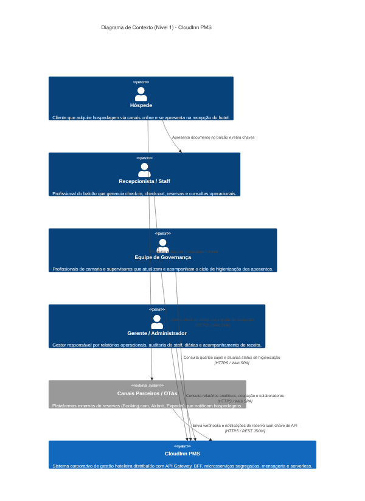

_Fonte Mermaid correspondente:_ `doc/diagrams/c4-contexto-cloudinn.mmd`

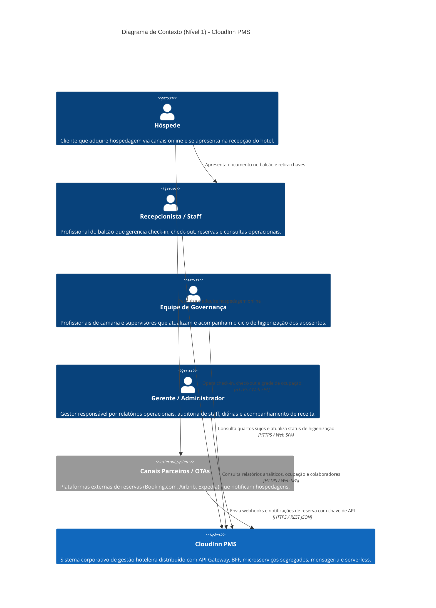

### 3.3 Contexto Técnico e Interfaces Externas

| Interface Externa            | Protocolo / Transporte | Formato de Carga |        Mecanismo de Autenticação         | Descrição e Finalidade                                                             |
| :--------------------------- | :--------------------: | :--------------: | :--------------------------------------: | :--------------------------------------------------------------------------------- |
| **Web App Microfrontend**    |    HTTPS / TLS 1.3     |   JSON / REST    |        Sessão Staff (Bearer JWT)         | Interface única do usuário, comunicando-se exclusivamente com o BFF.               |
| **Ingestão de Webhooks OTA** |      HTTPS / POST      |       JSON       |     API Key corporativa (`api_key`)      | Ponto de entrada de notificações de reservas originadas por parceiros comerciais.  |
| **Barramento de Mensagens**  |   AMQP 1.0 sobre TLS   | CloudEvents JSON |   Shared Access Signature (SAS Token)    | Troca assíncrona de eventos de domínio e integração via Azure Service Bus.         |
| **Cluster MongoDB Atlas**    |   MongoDB Wire / TLS   |   BSON binário   | Credenciais SCRAM-SHA-256 / VNet Peering | Comunicação privada e exclusiva do Hotel Service para dados de hotéis e quartos.   |
| **Azure SQL Database**       |   TDS sobre TLS 1.3    |  SQL Relacional  |   Azure AD / SQL Auth com IP Restrito    | Comunicação privada e exclusiva do Reservas/Guests Service para dados relacionais. |
| **Telemetria e Logs**        |   HTTPS / W3C Trace    |   JSON / OTLP    |  Instrumentation Key / Managed Identity  | Envio de métricas, traces distribuídos e logs para o Azure Application Insights.   |

---

## 4. Estratégia de Solução

### 4.1 Princípios Norteadores e Trade-Offs

1. **Segregação Estrita de Responsabilidades (BFF vs. API Gateway):**
   - _API Gateway (Azure API Management):_ Responsável por preocupações transversais de infraestrutura e rede — segurança de borda, terminação TLS, políticas mTLS, autenticação de chaves de API das OTAs, _rate limiting_, _circuit breaker_ de downstream e rastreamento distribuído com cabeçalhos W3C.
   - _Backend for Frontend (BFF):_ Responsável exclusivamente pela lógica de apresentação e composição de dados para a UI — agregação concorrente de serviços, transformação de modelos em DTOs customizados para as telas React, tratamento de falhas parciais e cache local de curta duração.
2. **Posicionamento do Gateway como Intermediário:**
   - Ao posicionar o API Gateway entre o BFF e os serviços internos (Hotel Service, Reservas/Guests Service e Azure Functions), cria-se um **Core Gateway Interno**. Isso garante que o BFF usufrua de _Service Discovery_, balanceamento de carga e políticas de segurança mTLS centralizadas, impedindo o acoplamento de URLs internas no código do BFF.
3. **Persistência Poliglota com Database per Service:**
   - _Azure SQL Database:_ Escolhido para Hóspedes e Reservas para garantir suporte a transações ACID estritas, integridade referencial forte e prevenção determinística de _overbooking_ através de índices e bloqueios pessimistas/otimistas em consultas de datas.
   - _MongoDB Atlas:_ Escolhido para Hotéis, Quartos, Staff e Governança devido à flexibilidade de atributos dinâmicos em aposentos (amenidades, características físicas, fotos), facilidade de indexação composta por empreendimento e independência de esquema para catálogo.
4. **Desacoplações Temporais com EDA (Event-Driven Architecture):**
   - Toda propagação de estado entre serviços (ex: confirmação de reserva, check-in, check-out) utiliza eventos assíncronos publicados no Azure Service Bus através do padrão **Transactional Outbox**, eliminando deadlocks distribuídos e garantindo que a falha temporária de um serviço não impeça a operação do outro.
5. **Computação Serverless Analítica Sob Demanda:**
   - Cálculos matemáticos complexos (projeções estatísticas de receita, RevPAR e taxas de ocupação por tipologia) são delegados a uma **Azure Function HTTP-triggered**, liberando a CPU dos microsserviços de negócio e permitindo escala elástica sob demanda.

### 4.2 Software Architecture Canvas Integrado

Para uma visão sintética e unificada de todo o sistema em uma única folha conceitual, o quadro a seguir consolida as 9 dimensões fundamentais do **Software Architecture Canvas** do CloudInn:

| 1. CONTEXTO & OBJETIVOS                                                                                                                                                                                                                                                                                                           | 2. ATORES & STAKEHOLDERS                                                                                                                                                                                                                                                                                                     | 3. CAPACIDADES DE NEGÓCIO                                                                                                                                                                                                                                                                                                                         |
| :-------------------------------------------------------------------------------------------------------------------------------------------------------------------------------------------------------------------------------------------------------------------------------------------------------------------------------- | :--------------------------------------------------------------------------------------------------------------------------------------------------------------------------------------------------------------------------------------------------------------------------------------------------------------------------- | :------------------------------------------------------------------------------------------------------------------------------------------------------------------------------------------------------------------------------------------------------------------------------------------------------------------------------------------------ |
| • PMS corporativo hoteleiro de alta densidade.• Eliminação do acoplamento legado de banco compartilhado.• Garantia de integridade transacional ACID nas reservas.• Agregação eficiente em chamada única para a SPA.• Resiliência interserviços via mensageria assíncrona.                                                         | • Recepcionistas (gestão ágil de balcão).• Governança e Camareiras (higienização).• Gerentes e Subgerentes (receita e auditoria).• Sistemas Parceiros / OTAs (Booking, Airbnb).• Hóspedes (agilidade e privacidade LGPD).• Engenharia (Clean Architecture e DevOps).                                                         | • Ingestão Idempotente de Reservas de OTAs.• Gestão Cadastral e Identificação de Hóspedes.• Controle de Ciclo de Vida de Reservas.• Alocação de Quartos e Prevenção de Overbooking.• Check-in e Check-out Sincronizados.• Governança Reativa e Liberação de Quartos.• CRUD de Empreendimento, Staff e Diárias.                                    |
| **4. ATRIBUTOS DE QUALIDADE**                                                                                                                                                                                                                                                                                                     | **5. RESTRIÇÕES & PREMISSAS**                                                                                                                                                                                                                                                                                                | **6. BLOCOS DE CONSTRUÇÃO**                                                                                                                                                                                                                                                                                                                       |
| • **Confiabilidade:** Zero overbooking concorrente.• **Desempenho:** P95 < 600ms no `GET /aggregated-data`.• **Resiliência:** Degradação parcial com `partial: true`.• **Segurança:** TLS 1.3, mTLS interno e RBAC restrito.• **Conformidade:** Mascaramento de dados para LGPD.                                                  | • Microfrontend React SPA existente preservado.• API Gateway como intermediário central de downstream.• Padrão _Database per Service_ obrigatório.• Azure Service Bus com Topics para EDA.• Node.js 22 LTS / Contêineres Docker independentes.• Custos otimizados em camadas PaaS/Serverless.                                | • **Client:** Microfrontend React SPA (Vite/Tailwind).• **Orquestração:** BFF Node.js (NestJS).• **Borda/Roteamento:** API Gateway (Azure APIM).• **Domínio 1:** Hotel Service (NestJS + MongoDB Atlas).• **Domínio 2:** Reservas Service (NestJS + Azure SQL).• **Serverless:** Azure Function Analítica (v4).                                   |
| **7. OWNERSHIP DE DADOS & EVENTOS**                                                                                                                                                                                                                                                                                               | **8. TECNOLOGIAS & DEPLOY**                                                                                                                                                                                                                                                                                                  | **9. RISCOS, DECISÕES & ROADMAP**                                                                                                                                                                                                                                                                                                                 |
| • **Hotel Service (MongoDB Atlas):** Coleções `hotels`, `rooms`, `staff`, `dailyRates`, `cleaningTasks`.• **Reservas Service (Azure SQL):** Tabelas `Guests`, `Reservations`, `IdempotencyKeys`, `OutboxMessages`.• **Eventos Centrais:** `ReservationCreated`, `CheckInCompleted`, `CheckOutCompleted`, `RoomCleaningCompleted`. | • **Hospedagem Front:** Azure Static Web Apps.• **Containers:** Azure Container Apps (com KEDA).• **Serverless:** Azure Function App (Flex Consumption).• **Mensageria:** Azure Service Bus Topics (Standard).• **Segredos:** Azure Key Vault & Managed Identity.• **Telemetria:** Azure Application Insights (W3C Tracing). | • **ADR-001:** Gateway entre BFF e microsserviços.• **ADR-002:** BFF dedicado para blindagem do front.• **ADR-003:** Database per Service com Azure SQL e Mongo.• **ADR-004:** Transactional Outbox contra perda de eventos.• **Risco:** Latência agregada -> Mitigada com cache TTL.• **Risco:** Falhas no broker -> Mitigada com DLQ e retries. |

---

## 5. Visão de Blocos de Construção

### 5.1 Diagrama C4 Nível 2 — Containers

O diagrama de containers apresenta os componentes de execução independentes da arquitetura do CloudInn, suas respectivas tecnologias e seus canais de comunicação:

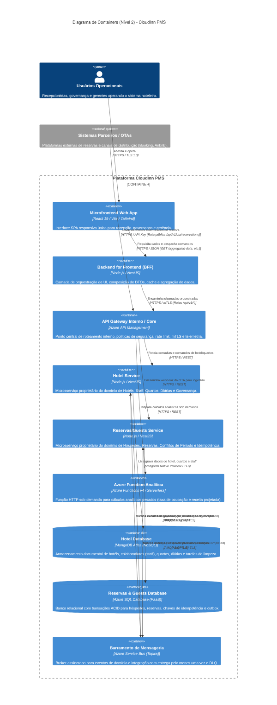

_Fonte Mermaid correspondente:_ `doc/diagrams/c4-containers-cloudinn.mmd`

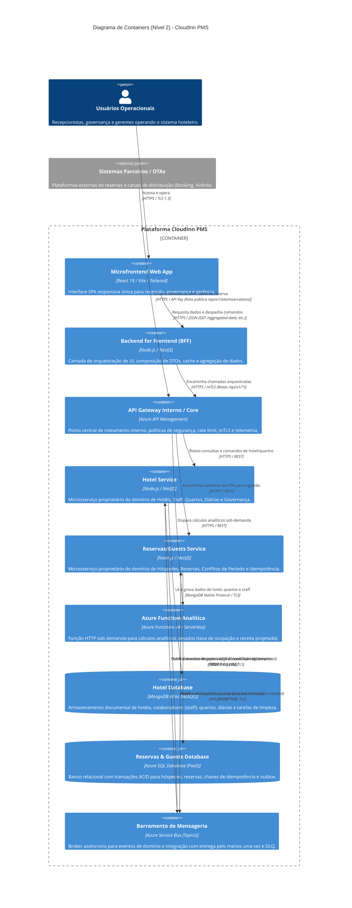

### 5.2 Diagramas C4 Nível 3 — Componentes por Container

#### 5.2.1 Componentes do Backend for Frontend (BFF)

O BFF NestJS decompõe-se em módulos de agregação, interceptores de resiliência, cliente HTTP para o API Gateway e camadas de DTO:

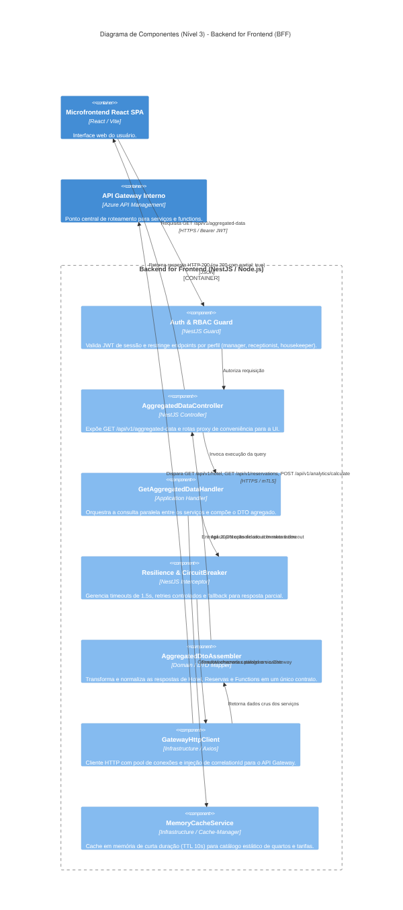

_Fonte Mermaid correspondente:_ `doc/diagrams/c4-componentes-bff.mmd`

#### 5.2.2 Componentes do API Gateway Interno (Azure API Management)

O API Gateway centraliza políticas de segurança de rede, rate limiting, injeção de correlationId e roteamento para os clusters internos:

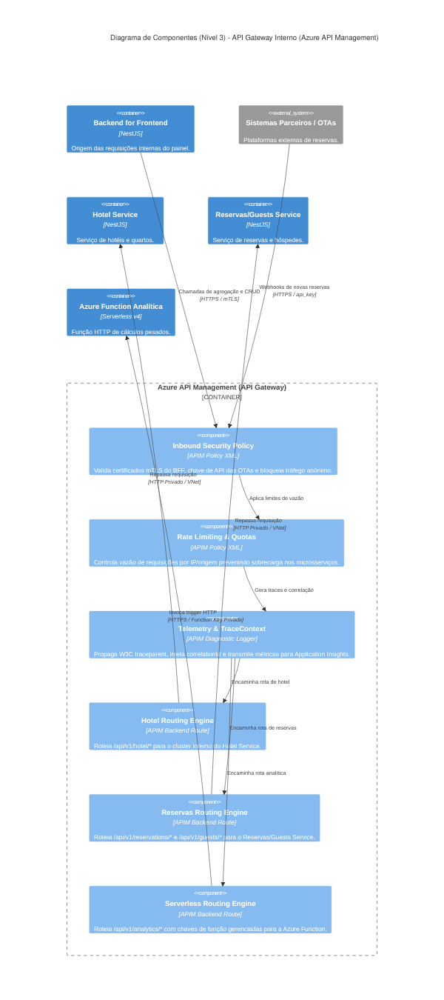

_Fonte Mermaid correspondente:_ `doc/diagrams/c4-componentes-gateway.mmd`

#### 5.2.3 Componentes do Hotel Service (MongoDB Atlas)

O Hotel Service é estruturado em Clean Architecture com Vertical Slices, isolando comandos de governança e quartos:

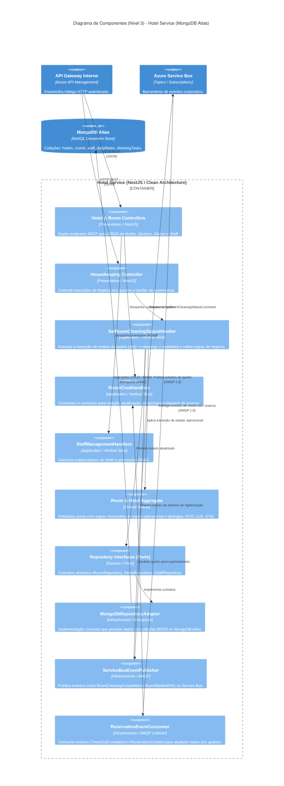

_Fonte Mermaid correspondente:_ `doc/diagrams/c4-componentes-hotel.mmd`

#### 5.2.4 Componentes do Reservas/Guests Service (Azure SQL Database)

O Reservas/Guests Service encapsula o aggregate de reserva, verificação de concorrência e o Transactional Outbox Worker:

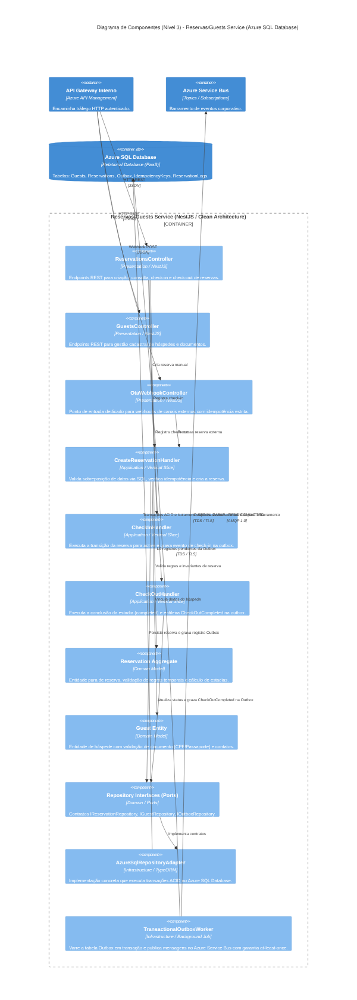

_Fonte Mermaid correspondente:_ `doc/diagrams/c4-componentes-reservas.mmd`

### 5.3 Diagramas C4 Nível 4 — Código por Vertical Slice

#### 5.3.1 Slice de Governança: `SetRoomCleaningStatus` (Hotel Service)

Esta fatia vertical demonstra a implementação de transição de estado de quartos com portas e adaptadores desacoplados:

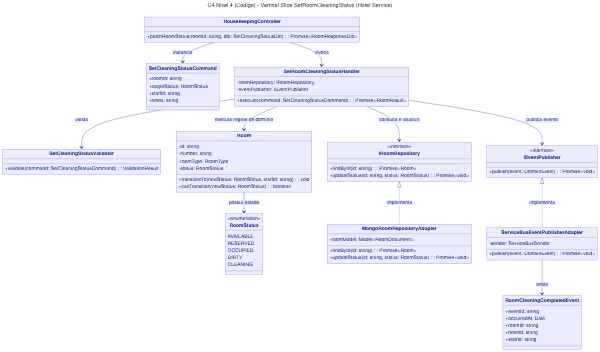

_Fonte Mermaid correspondente:_ `doc/diagrams/c4-codigo-hotel-slice.mmd`

#### 5.3.2 Slice de Reserva: `CreateReservation` (Reservas/Guests Service)

Demonstra o controle transacional, validação de sobreposição temporal via Value Object `DateRange` e persistência na Outbox:

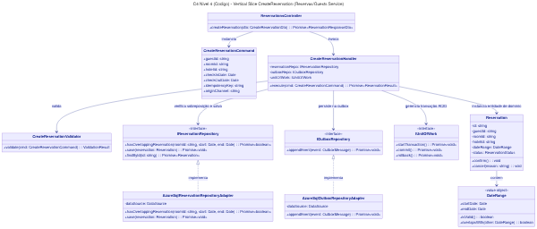

_Fonte Mermaid correspondente:_ `doc/diagrams/c4-codigo-reservas-slice.mmd`

#### 5.3.3 Slice de Agregação: `GetAggregatedData` (BFF)

Demonstra o handler de agregação concorrente, clientes com _circuit breaker_ e composição de resposta final:

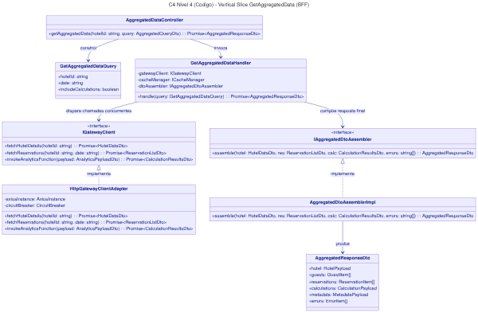

_Fonte Mermaid correspondente:_ `doc/diagrams/c4-codigo-bff-slice.mmd`

### 5.4 Diagrama UML de Componentes Distribuídos

O diagrama UML a seguir detalha os componentes de software em suas respectivas camadas de implantação lógica, exibindo suas portas e interfaces de comunicação:

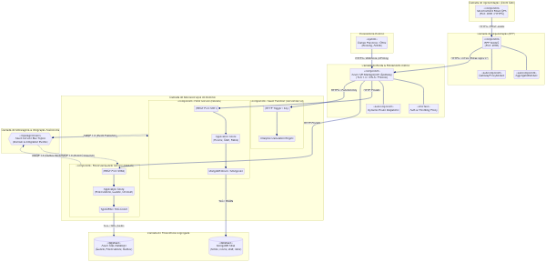

_Fonte Mermaid correspondente:_ `doc/diagrams/uml-componentes-distribuidos.mmd`

### 5.5 Diagrama UML de Classes de Domínio

O diagrama a seguir modela as entidades e agregados em seus respectivos _Bounded Contexts_, evidenciando que a ligação intercontextos se dá estritamente por identificadores lógicos remotos (`hotelIdRef`, `roomIdRef`):

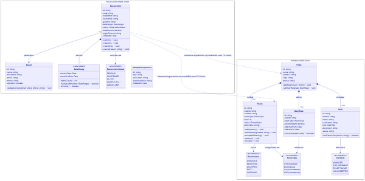

_Fonte Mermaid correspondente:_ `doc/diagrams/uml-classes-dominio.mmd`

### 5.6 Modelagem de Dados e Persistência Segregada

#### 5.6.1 Modelo Relacional — Azure SQL Database (Reservas/Guests Service)

O Azure SQL Database é o guardião da integridade transacional de hóspedes e estadias:

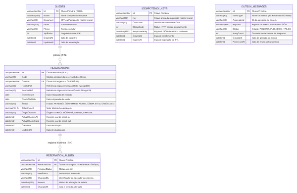

_Fonte Mermaid correspondente:_ `doc/diagrams/erd-azure-sql.mmd`

#### 5.6.2 Modelo Documental — MongoDB Atlas (Hotel Service)

O MongoDB Atlas gerencia documentos BSON com alta velocidade de leitura para o catálogo operacional:

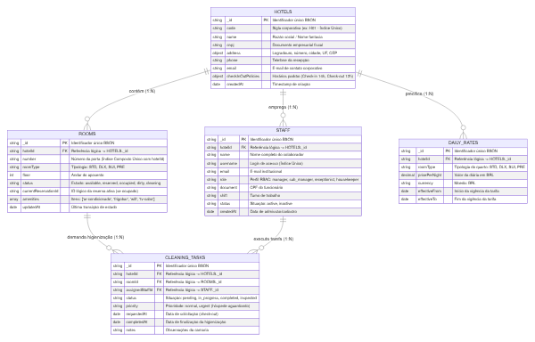

_Fonte Mermaid correspondente:_ `doc/diagrams/modelo-mongodb.mmd`

#### 5.6.3 Tabela de Ownership de Dados

| Entidade / Dado                          | Bounded Context Proprietário | Banco de Dados Físico | Consumidores Autorizados | Política de Acesso                                                   |
| :--------------------------------------- | :--------------------------- | :-------------------- | :----------------------- | :------------------------------------------------------------------- |
| **Hotéis (`hotels`)**                    | Hotel Service                | MongoDB Atlas         | BFF, Reservas Service    | Leitura via API Gateway; Escrita exclusiva Hotel Service.            |
| **Quartos (`rooms`)**                    | Hotel Service                | MongoDB Atlas         | BFF, Reservas Service    | Leitura via API Gateway; Escrita exclusiva Hotel Service.            |
| **Colaboradores (`staff`)**              | Hotel Service                | MongoDB Atlas         | BFF                      | Leitura e autenticação via Gateway; Escrita exclusiva Hotel Service. |
| **Diárias (`dailyRates`)**               | Hotel Service                | MongoDB Atlas         | BFF, Reservas Service    | Leitura via API Gateway; Escrita exclusiva Hotel Service.            |
| **Tarefas de Limpeza (`cleaningTasks`)** | Hotel Service                | MongoDB Atlas         | BFF                      | Leitura/Escrita exclusiva da governança no Hotel Service.            |
| **Hóspedes (`Guests`)**                  | Reservas/Guests Service      | Azure SQL Database    | BFF                      | Leitura via API Gateway; Escrita exclusiva Reservas Service.         |
| **Reservas (`Reservations`)**            | Reservas/Guests Service      | Azure SQL Database    | BFF, OTAs                | Leitura via API Gateway; Escrita exclusiva Reservas Service.         |
| **Idempotência (`IdempotencyKeys`)**     | Reservas/Guests Service      | Azure SQL Database    | OTAs / Parceiros         | Uso interno transacional para controle de duplicidade.               |
| **Mensagens Outbox (`OutboxMessages`)**  | Reservas/Guests Service      | Azure SQL Database    | Outbox Worker Interno    | Uso interno para garantia de despacho at-least-once.                 |

---

## 6. Visão de Tempo de Execução

### 6.1 Cenário 1: Carregamento do Painel Agregado

Demonstra a orquestração paralela realizada pelo BFF através do API Gateway, consultando Hotel Service, Reservas Service e a Azure Function analítica, retornando um único JSON consolidado para o microfrontend React:

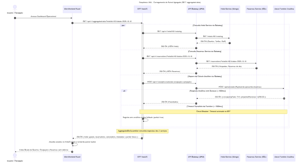

_Fonte Mermaid correspondente:_ `doc/diagrams/uml-sequencia-dashboard-agregado.mmd`

### 6.2 Cenário 2: Ingestão de Reserva via OTA e Anti-Overbooking

Apresenta a entrada de notificações de reservas externas pelo API Gateway, verificação de chave de idempotência no Azure SQL, bloqueio transacional de datas e publicação assíncrona na Outbox:

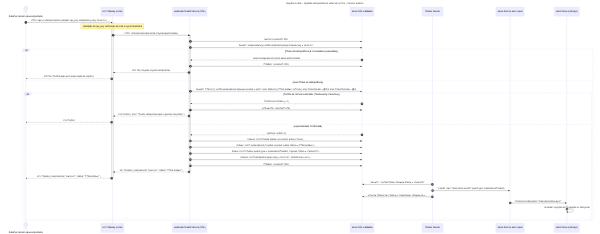

_Fonte Mermaid correspondente:_ `doc/diagrams/uml-sequencia-ingestao-ota.mmd`

### 6.3 Cenário 3: Fluxo de Check-in e Sincronização

Exibe o comando de check-in operado na recepção, atualização ACID da reserva no Azure SQL e propagação via Azure Service Bus para o Hotel Service atualizar o quarto físico para `occupied` no MongoDB:

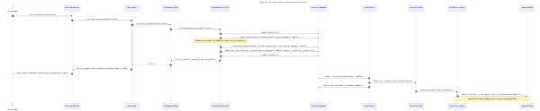

_Fonte Mermaid correspondente:_ `doc/diagrams/uml-sequencia-checkin.mmd`

### 6.4 Cenário 4: Check-out e Ciclo de Governança

Ilustra o encerramento da estadia, transição automática para quarto sujo (`dirty`), atribuição da ordem de limpeza e posterior liberação da camaria para `available`:

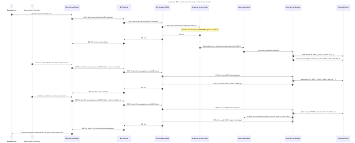

_Fonte Mermaid correspondente:_ `doc/diagrams/uml-sequencia-checkout-governanca.mmd`

### 6.5 Cenário 5: Cálculos Analíticos sob Demanda via Azure Function

Mostra a invocação da função serverless analítica com aplicação de limites de tempo e política de _fallback_ parcial caso ocorra lentidão:

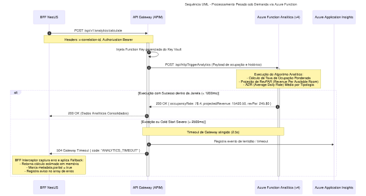

_Fonte Mermaid correspondente:_ `doc/diagrams/uml-sequencia-calculo-functions.mmd`

### 6.6 Cenário 6: Resiliência, Retries, Compensação e DLQ

Detalha o tratamento de falhas em mensagens do Azure Service Bus, aplicação de _backoff_ exponencial, transbordo para Dead-Letter Queue e execução de ações compensatórias (Saga):

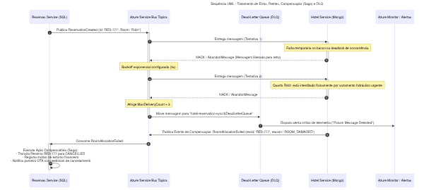

_Fonte Mermaid correspondente:_ `doc/diagrams/uml-sequencia-compensacao-saga.mmd`

---

## 7. Visão de Implantação

### 7.1 Topologia em Nuvem (Microsoft Azure & MongoDB Atlas)

A arquitetura de implantação foi projetada para execução em nuvem híbrida gerenciada, alocando os serviços de computação e dados em instâncias PaaS de alta disponibilidade:

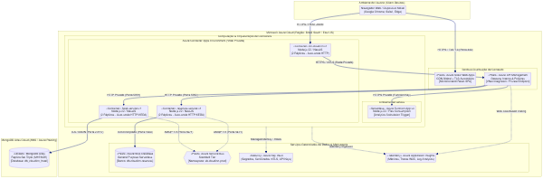

_Fonte Mermaid correspondente:_ `doc/diagrams/implantacao-cloudinn.mmd`

### 7.2 Estratégia de Conteinerização e Docker Hub

Cada microsserviço de backend possui seu próprio `Dockerfile` independente multi-stage, otimizando camadas e eliminando ferramentas de build na imagem de produção:

```dockerfile
# Exemplo ilustrativo de Dockerfile Multi-stage (Hotel Service / Reservas Service / BFF)
FROM node:22-alpine AS builder
WORKDIR /app
COPY package*.json ./
RUN npm ci
COPY . .
RUN npm run build

FROM node:22-alpine AS runner
WORKDIR /app
ENV NODE_ENV=production
COPY package*.json ./
RUN npm ci --only=production
COPY --from=builder /app/dist ./dist
USER node
EXPOSE 3000
CMD ["node", "dist/main.js"]
```

Comandos planejados para compilação e publicação de imagens no Docker Hub:

```bash
# Autenticação no Docker Hub
docker login -u <dockerhub-user>

# Build e Tag das Imagens Independentes
docker build -t <dockerhub-user>/cloudinn-bff:v3.0.0 ./bff
docker build -t <dockerhub-user>/cloudinn-hotel-service:v3.0.0 ./hotel-service
docker build -t <dockerhub-user>/cloudinn-reservas-service:v3.0.0 ./reservas-service

# Publicação no Registro Público
docker push <dockerhub-user>/cloudinn-bff:v3.0.0
docker push <dockerhub-user>/cloudinn-hotel-service:v3.0.0
docker push <dockerhub-user>/cloudinn-reservas-service:v3.0.0
```

### 7.3 Gestão de Ambientes e Segredos

- **Azure Key Vault:** Centraliza todos os segredos corporativos de infraestrutura (connection strings do MongoDB Atlas, credenciais do Azure SQL, chaves SAS do Service Bus e certificados mTLS).
- **Managed Identities:** Os serviços rodando em Azure Container Apps autenticam-se contra o Key Vault e Azure SQL via identidades gerenciadas (_System-Assigned Managed Identity_), eliminando senhas gravadas em variáveis de ambiente.
- **Isolamento de Rede (VNet):** O API Gateway e os serviços de backend comunicam-se através de sub-redes privadas (_Private Endpoints_), não expondo as portas dos microsserviços para a internet aberta.

---

## 8. Conceitos Transversais

### 8.1 Clean Architecture, SOLID e Vertical Slice Architecture

A organização interna do código do BFF e dos microsserviços segue uma estrutura que harmoniza **Clean Architecture** com **Vertical Slice Architecture**, agrupando o código por casos de uso e fatias de negócio:

```text
hotel-service/
├── src/
│   ├── features/                               # Vertical Slices por Funcionalidade
│   │   ├── create-hotel/
│   │   ├── update-room/
│   │   ├── set-room-cleaning-status/           # Slice detalhada no C4 Nível 4
│   │   │   ├── set-cleaning-status.controller.ts  # Presentation (API)
│   │   │   ├── set-cleaning-status.command.ts     # Application (DTO / Command)
│   │   │   ├── set-cleaning-status.handler.ts     # Application (Use Case Handler)
│   │   │   ├── set-cleaning-status.validator.ts   # Application (Validation)
│   │   │   └── set-cleaning-status.spec.ts        # Unit Tests
│   │   └── manage-staff-rbac/
│   ├── domain/                                 # Entidades Puras e Interfaces (Ports)
│   │   ├── entities/
│   │   │   ├── hotel.entity.ts
│   │   │   ├── room.entity.ts
│   │   │   └── staff.entity.ts
│   │   ├── value-objects/
│   │   ├── events/
│   │   └── ports/
│   │       ├── room-repository.port.ts
│   │       └── event-publisher.port.ts
│   └── infrastructure/                         # Adaptadores Concretos Externos
│       ├── persistence/
│       │   ├── mongo-room.repository.ts        # Implementação Mongoose
│       │   └── schemas/
│       └── messaging/
│           └── service-bus-publisher.adapter.ts
```

_Aplicação Observável dos Princípios SOLID:_

- **SRP (Single Responsibility Principle):** Cada slice possui seu próprio Handler dedicado que realiza estritamente um único caso de uso.
- **OCP (Open/Closed Principle):** Novos canais de notificação ou adaptadores de persistência podem ser inseridos implementando interfaces de porta sem modificar o domínio.
- **LSP (Liskov Substitution Principle):** Qualquer implementação de repositório (ex: mock em memória para testes ou adapter Mongoose) pode substituir a interface sem quebrar o handler.
- **ISP (Interface Segregation Principle):** Interfaces pequenas e especializadas (`IRoomRepository`, `IEventPublisher`) em vez de contratos monolíticos.
- **DIP (Dependency Inversion Principle):** O domínio não conhece nem importa Mongoose, TypeORM ou Azure SDK. As dependências apontam para dentro via injeção nativa do NestJS.

### 8.2 Contrato JSON Agregado do BFF (`GET /aggregated-data`)

O endpoint central consumido pela SPA React (`GET /api/v1/aggregated-data?hotelId=H01&date=2026-10-10`) consolida uma carga de dados estruturada, rica e protegida:

```json
{
  "hotel": {
    "id": "H01",
    "name": "CloudInn Resort & Hotel",
    "rooms": [
      {
        "id": "R101",
        "number": "101",
        "roomType": "STD",
        "floor": 1,
        "status": "available"
      },
      {
        "id": "R201",
        "number": "201",
        "roomType": "DLX",
        "floor": 2,
        "status": "occupied"
      },
      {
        "id": "R301",
        "number": "301",
        "roomType": "SUI",
        "floor": 3,
        "status": "dirty"
      }
    ],
    "dailyRates": [
      { "roomType": "STD", "pricePerNight": 280.0 },
      { "roomType": "DLX", "pricePerNight": 450.0 },
      { "roomType": "SUI", "pricePerNight": 750.0 }
    ],
    "staff": [
      {
        "id": "S01",
        "name": "Camila Rocha",
        "role": "receptionist",
        "shift": "Manhã"
      },
      {
        "id": "S02",
        "name": "Maria Aparecida",
        "role": "housekeeper",
        "shift": "Diurno"
      }
    ]
  },
  "guests": [
    {
      "id": "G10",
      "name": "João Silva",
      "document": "123.456.789-00",
      "email": "joao.silva@email.com",
      "phone": "+55 41 99999-9999",
      "vipStatus": false
    }
  ],
  "reservations": [
    {
      "id": "RES-501",
      "code": "CIN-8841",
      "guestId": "G10",
      "roomIdRef": "R201",
      "checkInDate": "2026-10-10T14:00:00Z",
      "checkOutDate": "2026-10-15T12:00:00Z",
      "status": "ACTIVE",
      "totalAmount": 2250.0,
      "originChannel": "BOOKING"
    }
  ],
  "calculations": {
    "occupancyRate": 78.5,
    "projectedRevenue": 14250.0,
    "revPar": 265.4,
    "roomsCleaningPending": 4
  },
  "metadata": {
    "generatedAt": "2026-10-10T09:15:30Z",
    "correlationId": "corr-c7e19d50-93bf-4d87-8d02",
    "partial": false,
    "cacheHit": false
  },
  "errors": []
}
```

### 8.3 Comunicação Orientada a Eventos (EDA)

A topologia do barramento é estruturada no Azure Service Bus com mensagens formatadas segundo o padrão aberto **CloudEvents v1.0**:

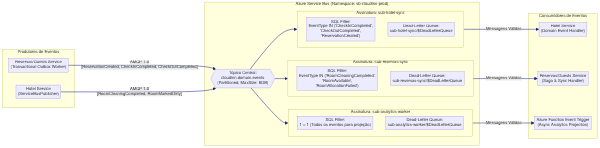

_Fonte Mermaid correspondente:_ `doc/diagrams/fluxo-eventos-eda.mmd`

_Exemplo de Contrato JSON de Evento (`ReservationCreated`):_

```json
{
  "specversion": "1.0",
  "type": "com.cloudinn.reservations.reservationcreated",
  "source": "/services/reservas-guests",
  "id": "evt-77f4e8b2-3a1b-4f9e-9d2a",
  "time": "2026-10-10T09:14:02Z",
  "datacontenttype": "application/json",
  "correlationid": "corr-c7e19d50-93bf-4d87-8d02",
  "causationid": "cmd-ingest-ota-98721",
  "data": {
    "reservationId": "RES-501",
    "code": "CIN-8841",
    "hotelId": "H01",
    "roomId": "R201",
    "guestId": "G10",
    "checkInDate": "2026-10-10T14:00:00Z",
    "checkOutDate": "2026-10-15T12:00:00Z",
    "originChannel": "BOOKING",
    "totalAmount": 2250.0
  }
}
```

### 8.4 Segurança, RBAC e Conformidade com LGPD

- **Autenticação e Autorização:** O frontend transmite tokens JWT gerados no login de staff contendo a claim `role`. Os Guards do NestJS validam as permissões:
  - `manager`: Acesso total a relatórios analíticos, staff, diárias e auditoria.
  - `receptionist`: Execução de check-in, check-out e criação manual de reservas.
  - `housekeeper`: Restrita à consulta de quartos e atualização de status de higienização.
- **Conformidade LGPD:**
  - Documentos de hóspedes são cifrados em repouso no Azure SQL via _Transparent Data Encryption_ (TDE).
  - Logs de telemetria recebem filtros automáticos que substituem CPFs por formato mascarado (`***.456.789-**`).
  - Eventos de integração trafegam apenas dados estritamente necessários para a sincronização operacional.

### 8.5 Observabilidade, Rastreamento Distribuído e Telemetria

Toda a esteira de requisições implementa o padrão **W3C TraceContext** (`traceparent`, `tracestate`):

1. O cliente ou API Gateway gera um identificador único de rastreamento (`x-correlation-id`).
2. O API Gateway propaga o contexto W3C para o BFF e microsserviços.
3. O Azure Application Insights correlaciona a viagem de rede completa em um único grafo de dependências (_Application Map_), viabilizando identificação imediata de gargalos ou falhas em qualquer elo da cadeia.

---

## 9. Decisões Arquiteturais (ADRs)

### ADR-001: Posicionamento do API Gateway como Intermediário Central de Downstream

- **Status:** Aprovada / Projetada
- **Contexto:** O microfrontend consome o BFF diretamente para obter respostas moldadas para a tela. Era necessário decidir se o Gateway ficaria à frente do BFF ou entre o BFF e os serviços internos.
- **Decisão:** O API Gateway (Azure API Management) foi posicionado entre o BFF e os serviços downstream (Hotel Service, Reservas Service e Azure Functions).
- **Consequências:** O BFF atua como cliente autenticado do Gateway. O Gateway centraliza isolamento de rede, mTLS, descoberta de serviços internos, limitação de taxa e telemetria unificada.

### ADR-002: Adoção do BFF NestJS para Agregação e Blindagem da Interface

- **Status:** Aprovada / Projetada
- **Contexto:** A interface web precisa de dados simultâneos de hotéis, quartos, hóspedes, reservas e indicadores analíticos para carregar o painel da recepção.
- **Decisão:** Criar um Backend for Frontend em Node.js (NestJS) expondo `GET /aggregated-data`.
- **Consequências:** Reduz chamadas do browser de 4 para 1 viagem de rede; isola o front-end de lidar com falhas de microsserviços individuais; viabiliza cache de dados estáticos.

### ADR-003: Segregação de Persistência (Database per Service) com Azure SQL e MongoDB Atlas

- **Status:** Aprovada / Projetada
- **Contexto:** A arquitetura legada mantinha um banco MongoDB compartilhado, inviabilizando transações relacionais atômicas para prevenção de overbooking.
- **Decisão:** Reservas e Hóspedes migram para o Azure SQL Database com transações ACID. Hotéis, Quartos e Staff permanecem no MongoDB Atlas.
- **Consequências:** Elimina acoplamento; garante zero overbooking em reservas concorrentes; exige consistência eventual e mensageria assíncrona entre os domínios.

### ADR-004: Comunicação Orientada a Eventos com Transactional Outbox

- **Status:** Aprovada / Projetada
- **Contexto:** O envio direto de mensagens HTTP entre microsserviços para sincronizar check-in e check-out gerava risco de indisponibilidade em cascata e perda de dados.
- **Decisão:** Adotar Azure Service Bus com padrão Transactional Outbox nos serviços produtores.
- **Consequências:** Garante entrega pelo menos uma vez (_at-least-once_); desacopla a disponibilidade dos serviços; exige consumidores idempotentes.

### ADR-005: Descontinuação do CRUD em Azure Functions e Conversão para Serverless Analítico

- **Status:** Aprovada / Projetada
- **Contexto:** Funções serverless antigas (`fc_gp_cloudInn_insert`, etc.) atuavam como repositórios procedurais diretos sem modelo de domínio.
- **Decisão:** Descontinuar o CRUD nas Functions e transferir a lógica de domínio para os microsserviços NestJS. A computação serverless é mantida exclusivamente para rotinas analíticas pesadas (cálculo de RevPAR e taxa de ocupação).
- **Consequências:** Código coeso em Clean Architecture; eliminação de cold starts em operações diárias do balcão; custo serverless reduzido.

---

## 10. Requisitos de Qualidade

### Árvore de Qualidade ISO/IEC 25010

```
ISO/IEC 25010 (CloudInn)
├── Confiabilidade (Reliability)
│   ├── Tolerância a Falhas (Fault Tolerance) ──► Circuit Breaker no BFF & Fallback Parcial
│   └── Recuperabilidade (Recoverability) ─────► Transactional Outbox & Dead-Letter Queue (DLQ)
├── Eficiência de Desempenho (Performance)
│   ├── Comportamento Temporal (Time Behavior) ─► P95 < 600ms no GET /aggregated-data
│   └── Utilização de Recursos (Resource Util.) ─► Cache em Memória TTL 10s no BFF
├── Segurança (Security)
│   ├── Confidencialidade (Confidentiality) ───► Criptografia TLS 1.3 & mTLS interno
│   ├── Integridade (Integrity) ────────────────► Restrições ACID contra Overbooking no Azure SQL
│   └── Autenticidade (Authenticity) ───────────► JWT com RBAC e API Keys para OTAs
└── Manutenibilidade (Maintainability)
    ├── Modularidade (Modularity) ──────────────► Database per Service & Vertical Slices
    └── Testabilidade (Testability) ────────────► Ports & Adapters com Injeção de Dependências
```

### Cenários de Qualidade Detalhados

1. **Cenário Q1 — Prevenção de Overbooking sob Concorrência Máxima:**
   - _Estímulo:_ 50 requisições simultâneas de canais parceiros tentando reservar o quarto 201 para as mesmas datas.
   - _Ambiente:_ Operação normal em horário de pico.
   - _Resposta:_ O Reservas/Guests Service executa transação no Azure SQL sob nível de isolamento apropriado.
   - _Medida:_ Exatamente 1 reserva é confirmada (HTTP 201); 49 recebem HTTP 409 Conflict em menos de 500ms.
2. **Cenário Q2 — Degradação Graciosa sob Indisponibilidade de Serviço Analítico:**
   - _Estímulo:_ A Azure Function analítica sofre sobrecarga ou timeout (> 1500ms).
   - _Ambiente:_ Recepção carregando painel operacional.
   - _Resposta:_ O interceptor do BFF intercepta a falha, injeta valores padrão calculados em cache e responde a UI.
   - _Medida:_ A interface web carrega em < 600ms, exibindo os quartos normalmente com `metadata.partial = true`.
3. **Cenário Q3 — Proteção de Dados de Hóspedes (LGPD):**
   - _Estímulo:_ Inspeção de logs de telemetria no Application Insights por operador de sustentação.
   - _Ambiente:_ Ambiente de produção.
   - _Resposta:_ O pipeline de log aplica sanitização regex em campos sensíveis.
   - _Medida:_ 100% dos documentos e contatos aparecem mascarados nos logs e traces.

---

## 11. Riscos e Dívidas Técnicas

### Matriz de Riscos de Engenharia

| Risco Técnico Identificado                                | Probabilidade | Impacto | Medida Preventiva / Mitigatória Adotada                                                                                                  | Responsável Sugerido |
| :-------------------------------------------------------- | :-----------: | :-----: | :--------------------------------------------------------------------------------------------------------------------------------------- | :------------------- |
| **R01: Latência Excessiva na Agregação do BFF**           |     Média     |  Alto   | Disparo de chamadas paralelas via `Promise.all` através do Gateway e cache local de catálogo estático com TTL de 10s.                    | Alyson Ferreira      |
| **R02: Concorrência e Conflito de Overbooking**           |     Baixa     | Crítico | Transações ACID relacionais no Azure SQL com índices filtrados e verificação rigorosa de sobreposição temporal de datas.                 | Flavia Cristina      |
| **R03: Inconsistência Eventual entre Quartos e Reservas** |     Média     |  Médio  | Padrão Transactional Outbox com reenvio automático e monitoramento de Dead-Letter Queues no Azure Service Bus.                           | Matheus Siqueira     |
| **R04: Custos Elevados em Serviços PaaS de Nuvem**        |     Alta      |  Médio  | Adoção de camadas Serverless (Azure SQL Serverless com auto-pause e Azure Container Apps com KEDA escalando para zero réplicas ociosas). | Matheus Siqueira     |
| **R05: Sobrecarga do API Gateway Interno**                |     Baixa     |  Alto   | Dimensionamento do Azure API Management com políticas de cache HTTP local e pooling de conexões mTLS do BFF.                             | Alyson Ferreira      |
| **R06: Complexidade de Transição do Código Legado**       |     Média     |  Médio  | Preservação total do frontend e implementação isolada dos novos microsserviços em repositórios próprios com testes de regressão.         | Lucas Aioria         |

---

## 12. Glossário

| Termo / Sigla                        | Definição no Contexto do CloudInn                                                                                                                 |
| :----------------------------------- | :------------------------------------------------------------------------------------------------------------------------------------------------ |
| **ADR (Average Daily Rate)**         | Métrica hoteleira que indica a receita média auferida por quarto ocupado em determinado período.                                                  |
| **API Gateway**                      | Ponto central de roteamento, controle de tráfego, terminação TLS e segurança de borda que intermedeia o acesso aos microsserviços.                |
| **BFF (Backend for Frontend)**       | Padrão arquitetural que fornece uma camada de backend especializada nas necessidades e formato de tela de uma interface cliente específica.       |
| **Bounded Context**                  | Fronteira conceitual delimitada (DDD) onde um modelo de domínio particular se aplica com termos e regras exclusivos.                              |
| **Clean Architecture**               | Arquitetura de software concêntrica proposta por Robert C. Martin que isola as regras de negócio puras de frameworks e bancos de dados.           |
| **CloudEvents**                      | Especificação aberta para descrição padronizada de metadados de eventos em sistemas distribuídos e orientados a eventos.                          |
| **Database per Service**             | Padrão em que cada microsserviço possui seu próprio banco de dados privado, impedindo acesso físico cruzado por outros serviços.                  |
| **DLQ (Dead-Letter Queue)**          | Fila de descarte de mensagens com falhas permanentes ou excesso de tentativas de entrega para análise e reprocessamento posterior.                |
| **EDA (Event-Driven Architecture)**  | Paradigma arquitetural baseado na produção, detecção e consumo assíncrono de eventos de domínio.                                                  |
| **Idempotência**                     | Propriedade de uma operação que garante que múltiplos envios idênticos produzam exatamente o mesmo efeito sem duplicidades.                       |
| **KEDA**                             | _Kubernetes Event-driven Autoscaling_ — componente de auto-escala baseado em métricas de filas e tráfego de rede no Azure Container Apps.         |
| **LGPD**                             | Lei Geral de Proteção de Dados (Lei nº 13.709/2018) que regulamenta o tratamento de dados pessoais no Brasil.                                     |
| **Microfrontend**                    | Extensão dos conceitos de microsserviços para a camada de interface do usuário, desacoplando aplicações web em módulos independentes.             |
| **mTLS (Mutual TLS)**                | Autenticação mútua baseada em certificados digitais TLS onde tanto o cliente quanto o servidor validam a identidade um do outro.                  |
| **OTA (Online Travel Agency)**       | Agências de turismo e plataformas online de venda de acomodações (Booking.com, Airbnb, Expedia).                                                  |
| **Outbox Pattern**                   | Padrão que persiste eventos na mesma transação atômica do banco de dados relacional para despacho assíncrono confiável posterior.                 |
| **PMS (Property Management System)** | Sistema central corporativo para gestão de hospitalidade, reservas, ocupação, faturamento e governança de um hotel.                               |
| **RevPAR**                           | _Revenue Per Available Room_ — indicador hoteleiro chave calculado pela receita total de diárias dividida pelo total de quartos disponíveis.      |
| **RBAC**                             | _Role-Based Access Control_ — controle de acesso a funcionalidades do sistema baseado nos papéis e funções dos colaboradores.                     |
| **Saga (Coreografada)**              | Padrão para coordenação de transações de negócio distribuídas através da troca de eventos e comandos de compensação sem orquestrador central.     |
| **Serverless**                       | Modelo de computação em nuvem onde a infraestrutura é provisionada e escalada dinamicamente pelo provedor sob demanda de execução.                |
| **Vertical Slice Architecture**      | Organização arquitetural onde o código é particionado em fatias verticais por funcionalidade/caso de uso, em vez de camadas técnicas horizontais. |

---

## Anexo: Matriz de Evidências Futuras de Entrega

A tabela a seguir consolida a rastreabilidade das entregas acadêmicas e de engenharia planejadas para a implementação física da arquitetura, registrando de forma transparente a situação atual:

| Evidência de Entrega                    |    Situação Verificada    | Link Verificável / Repositório Planejado                                             |
| :-------------------------------------- | :-----------------------: | :----------------------------------------------------------------------------------- |
| **GitHub — Microfrontend React**        | Verificado no Repositório | `https://github.com/LucasAioriaSerpa/CloudInn` (Diretório `/frontend`)               |
| **GitHub — Backend for Frontend (BFF)** |       A Implementar       | `https://github.com/LucasAioriaSerpa/cloudinn-bff` (Pendente criação)                |
| **GitHub — Hotel Service**              |       A Implementar       | `https://github.com/LucasAioriaSerpa/cloudinn-hotel-service` (Pendente criação)      |
| **GitHub — Reservas/Guests Service**    |       A Implementar       | `https://github.com/LucasAioriaSerpa/cloudinn-reservas-service` (Pendente criação)   |
| **GitHub — Azure Function Analítica**   |       A Implementar       | `https://github.com/LucasAioriaSerpa/cloudinn-analytics-function` (Pendente criação) |
| **Docker Hub — Imagens de Contêineres** |        A Publicar         | `https://hub.docker.com/u/cloudinn` (Pendente publicação)                            |
| **Swagger / OpenAPI — BFF e Serviços**  |   Contratos Projetados    | Planejado em cada repositório em `/docs/openapi.yaml`                                |
| **URL Pública — Microfrontend**         |  Em Validação de Deploy   | Azure Static Web Apps (Pendente publicação oficial)                                  |
| **URL Pública — API Gateway**           |       A Provisionar       | Azure API Management (Pendente provisionamento de nuvem)                             |
| **Vídeo Demonstrativo no YouTube**      |        A Produzir         | Gravação com demonstração em nuvem (Pendente gravação)                               |
